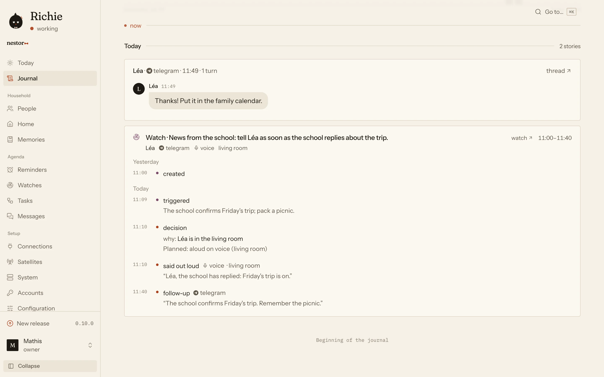
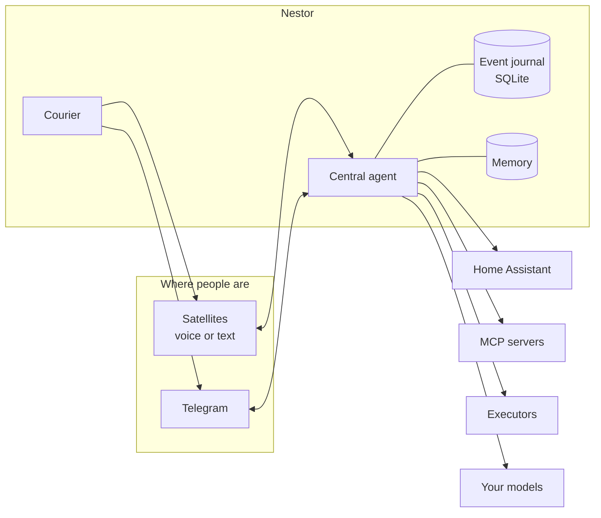

<p align="center">
  <a href="https://nestorhome.dev">
    <picture>
      <source media="(prefers-color-scheme: dark)" srcset="https://raw.githubusercontent.com/nestor-home/nestor/main/.github/assets/banner-dark.png">
      
    </picture>
  </a>
</p>

<p align="center">
  <a href="https://pypi.org/project/nestor-home/"></a>
  <a href="https://pypi.org/project/nestor-home/"></a>
  <a href="https://github.com/nestor-home/nestor/pkgs/container/nestor"></a>
  <a href="https://github.com/nestor-home/nestor/actions/workflows/ci.yml"></a>
  <a href="LICENSE"></a>
</p>

<p align="center">
  <a href="https://nestorhome.dev">Website</a> ·
  <a href="https://nestorhome.dev/docs/quickstart/">Quickstart</a> ·
  <a href="https://nestorhome.dev/docs/">Documentation</a> ·
  <a href="https://github.com/orgs/nestor-home/discussions">Discussions</a> ·
  <a href="CHANGELOG.md">Changelog</a>
</p>

**Nestor** is an open-source framework for a household assistant. It runs on your machine with the
model you choose, answers in a message or aloud, keeps watch for you, and finds the right person in
the right place. Every word it says is in a journal you can read.

<p align="center">
  <picture>
    <source media="(prefers-color-scheme: dark)" srcset="https://raw.githubusercontent.com/nestor-home/nestor/main/.github/assets/journal-dark.webp">
    
  </picture>
</p>

## What it does

- **One assistant, every channel.** Satellites in each room (a speaker, a Reachy Mini, a browser, a
  terminal) and Telegram reach the same agent, with the same memory. Satellites can type, talk, or both.
- **Native Home Assistant.** Presence, rooms and devices come from Home Assistant, and Nestor acts
  through its MCP server. Locks, alarms and garage doors wait for a confirmation in writing.
- **It speaks first when it matters.** Watches on your mail, reminders and recurring checks, messages
  between members of the household. The courier says it aloud in your room or writes to you when you
  are out, respects quiet hours, and stays silent when a check finds nothing.
- **Memory you can read.** Dated, sourced facts and summaries of past conversations, found by words and
  by meaning, all visible and editable in the admin.
- **Long work, elsewhere.** Long tasks go to executors such as [Hermes](https://github.com/NousResearch/hermes-agent);
  a slow tool keeps running in the background and its result comes back into the conversation.
- **Any model.** Any OpenAI-compatible server, hosted or local (Ollama, LM Studio, vLLM, llama.cpp),
  one for speaking and another for writing if you like.
- **Who is speaking.** Optional voice recognition, run on your server and opt-in per person. It
  personalises; it never authorises.
- **A journal of everything.** Every turn, tool call, decision and delivery is an event in SQLite, with
  why it happened. The admin is built on it.

## Quickstart

With [uv](https://docs.astral.sh/uv/) and a model key ([OpenRouter](https://openrouter.ai/keys) or any
OpenAI-compatible server):

```bash
uv tool install nestor-home
mkdir nestor && cd nestor
nestor init          # asks a few questions, writes nestor.yaml, .env and your admin login
nestor check         # after filling MODEL_API_KEY in .env
nestor run           # the admin is on http://localhost:8470
```

Talk to it from a second terminal, with a text satellite:

```bash
nestor satellites add --room office --name Terminal
uvx nestor-satellite run --room office --text --no-voice --pairing-uri 'nestor+http://…'
```

With Docker:

```bash
docker run -it --rm -v ./nestor:/data ghcr.io/nestor-home/nestor init
docker run -d --name nestor --restart unless-stopped -v ./nestor:/data -p 8470:8470 -p 8471:8471 ghcr.io/nestor-home/nestor
```

Voice is an extra (`nestor-home[voice]`), and so is voice recognition (`nestor-home[voice-id]`). See
[Installation](https://nestorhome.dev/docs/install/), [Configuration](https://nestorhome.dev/docs/configuration/)
and [Models](https://nestorhome.dev/docs/models/).

## How it fits together



The central agent stays fast: what is long goes to an executor, and what comes back later (a task's
result, a watch, a reminder) enters the conversation as a notification that the courier delivers where
the person is. [How it works](https://nestorhome.dev/docs/agent/) goes further.

## Integrations

| | |
|---|---|
| **Models** | Any OpenAI-compatible API: OpenRouter, OpenAI, Anthropic, Mistral, Groq, Gemini; locally Ollama, LM Studio, vLLM, llama.cpp |
| **Voice** | ElevenLabs (transcription and speech), voice recognition with sherpa-onnx |
| **Home** | Home Assistant, and everything it controls (Hue, IKEA, Sonos, tado°…) |
| **Channels** | Satellites (`nestor.satellite/1`), Telegram |
| **Mail** | Gmail, IMAP |
| **Tools and work** | Any MCP server, Hermes |

Each one is a plugin: another provider is another adapter, with no change to the core.

## Satellites

A satellite is any device in a room that types, listens or speaks, connected over the
[`nestor.satellite/1`](https://nestorhome.dev/docs/satellites/protocol/) protocol.
`nestor satellites conformance` checks one written in any language.

| | Package | Repository |
|---|---|---|
| Python | [`nestor-satellite`](https://pypi.org/project/nestor-satellite/) | [nestor-satellite-python](https://github.com/nestor-home/nestor-satellite-python) |
| TypeScript | [`@nestor-home/satellite`](https://www.npmjs.com/package/@nestor-home/satellite) | [nestor-satellite-typescript](https://github.com/nestor-home/nestor-satellite-typescript) |
| Rust | [`nestor-satellite`](https://crates.io/crates/nestor-satellite) | [nestor-satellite-rust](https://github.com/nestor-home/nestor-satellite-rust) |
| Reachy Mini | [`nestor-reachy`](https://pypi.org/project/nestor-reachy/) | [nestor-reachy](https://github.com/nestor-home/nestor-reachy) |

To start your own, use a template:
[Python](https://github.com/nestor-home/nestor-satellite-template-python),
[TypeScript](https://github.com/nestor-home/nestor-satellite-template-typescript) or
[Rust](https://github.com/nestor-home/nestor-satellite-template-rust).

## Status

Nestor is young and moves fast. Until 1.0, a minor release may change the configuration or the
journal's format without a migration: read the [changelog](CHANGELOG.md) before you upgrade.

## Development

```bash
uv sync
uv run pre-commit install
uv run ruff check && uv run ruff format --check && uv run ty check && uv run pytest
```

The admin (`web/`) is a React app built into the package and served by Nestor. It needs Node 22 or
later and pnpm:

```bash
cd web
pnpm install
pnpm dev                                    # on the mock API; sign in as mathis / nestor
NESTOR_API=http://localhost:8470 pnpm dev   # against a running Nestor
pnpm lint && pnpm typecheck && pnpm test && pnpm build
pnpm e2e                                    # Playwright on the mocks, light and dark
```

`nestor bench` measures a part of Nestor on a dataset and compares configurations, for instance which
small model sorts your mail best and at what cost:

```bash
nestor bench list
nestor bench run watch-triage --variant a.yaml --variant b.yaml --repeat 3
nestor bench report bench-results/watch-triage/<run>
```

How the code is laid out and the rules it follows are in [AGENTS.md](AGENTS.md); how pull requests and
releases work is in the [contributing guide](https://github.com/nestor-home/.github/blob/main/CONTRIBUTING.md).
Questions and ideas go to [Discussions](https://github.com/orgs/nestor-home/discussions), vulnerabilities
to the [security policy](https://github.com/nestor-home/.github/blob/main/SECURITY.md).

## License

[MIT](LICENSE)
